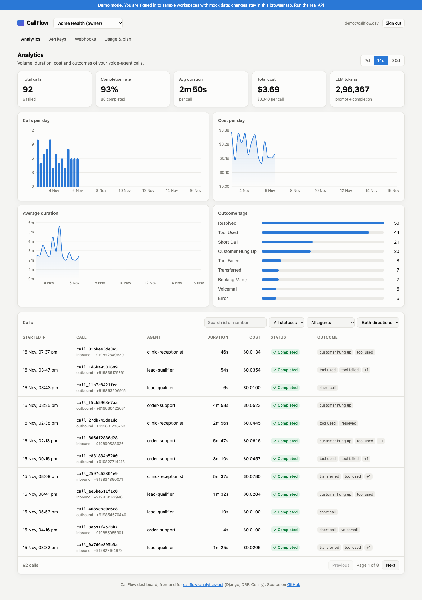
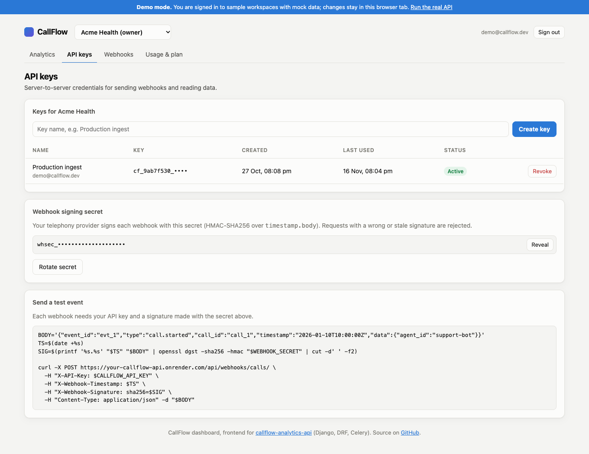
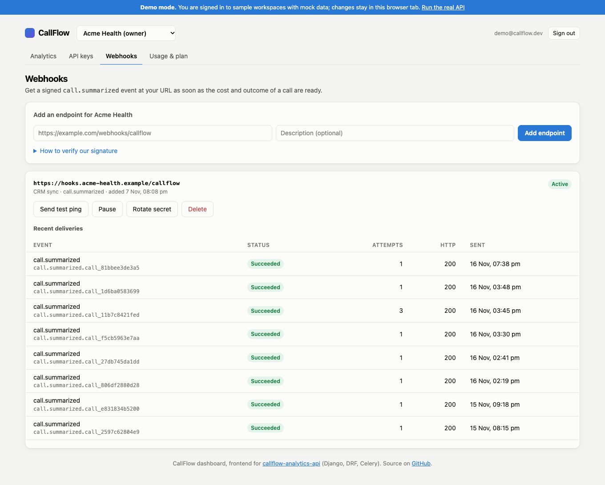
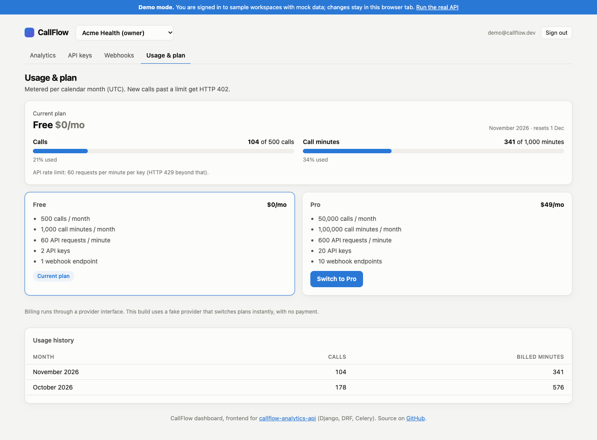

# CallFlow Dashboard

[](https://github.com/Vedansh-0611/callflow-dashboard/actions/workflows/deploy.yml)

**Live demo: https://vedansh-0611.github.io/callflow-dashboard/**

The web app for **CallFlow**, a multi-tenant call analytics service for AI voice agents. Teams
sign in, switch between their organizations, watch call volume, cost and outcomes, manage the
API keys their telephony provider uses, register webhook endpoints for `call.summarized`
events, and keep an eye on usage against their plan.

The backend is **[callflow-analytics-api](https://github.com/Vedansh-0611/callflow-analytics-api)**
(Django, DRF, Celery, PostgreSQL, Redis). The live demo runs in **demo mode**: no backend, a
banner at the top, and an automatic sign-in to two sample organizations backed by an in-browser
mock of the API.



<details>
<summary>API keys, webhooks, usage and plan, call drawer (dark mode)</summary>






</details>

## Features

- **Sign in / sign up** with email and password against the API's JWT endpoints. The access
  token is refreshed automatically (one shared refresh even when several requests expire at once).
- **Org switcher** in the header. Every request carries `X-Organization`, and pages remount on a
  switch so nothing from the previous organization stays on screen. New organizations can be
  created from the same menu.
- **Analytics:** KPI cards, calls / cost / duration per day, outcome tags, a filterable and
  sortable calls table, and a call drawer with the full event timeline.
- **API keys:** create a key and see it exactly once (with copy), revoke keys, see when each was
  last used; reveal or rotate the inbound webhook signing secret; a ready-to-run signed `curl`.
- **Webhooks:** add endpoints for `call.summarized` (signing secret shown once), pause or resume,
  rotate secrets, send a test ping and read the delivery log with attempts and status codes.
- **Usage & plan:** meters for calls and minutes this month, plan cards with limits, switching
  plans through the API's billing provider, and usage history.
- **Roles:** members see analytics and usage; owners and admins also manage keys, endpoints
  and the plan. The UI explains the role instead of showing raw 403s.
- Light and dark themes, responsive down to phone width, no UI framework.

## Demo mode vs real mode

| | Demo mode (default, GitHub Pages) | Real mode |
|---|---|---|
| Turned on by | `VITE_API_URL` empty | `VITE_API_URL=https://your-api` |
| Sign-in | automatic; any credentials work | email + password, JWT |
| Data | bundled mock calls, split across two sample orgs | your organization's data |
| Keys, endpoints, plan | kept in memory for the tab, same shapes and errors (including 402 limits) as the API | stored by the API |

```bash
npm install
npm run dev                      # demo mode on http://localhost:5173

# real mode, with the API running locally (make up && make seed in the API repo)
echo "VITE_API_URL=http://localhost:8000" > .env.local
npm run dev                      # sign in as demo@callflow.dev / callflow-demo
```

The API already allows `http://localhost:5173` through `CORS_ALLOWED_ORIGINS`.

## How it is built

```
src/
  api/http.js          fetch wrapper: JWT + X-Organization headers, token refresh, error messages
  api/session.js       tokens, user and selected org in localStorage
  api/client.js        one function per endpoint; picks the real API or the mock
  api/mockApi.js       in-browser mock of the API for demo mode
  auth/AuthContext.jsx sign-in state, org switching, demo auto sign-in
  pages/               Analytics, API keys, Webhooks, Usage & plan, sign-in / sign-up
  components/          charts, tables, call drawer, usage meter, copy field, app shell
  useHashRoute.js      #/billing style routing (works on GitHub Pages without rewrites)
  useAsync.js          data loading hook that ignores stale responses
```

- **One data layer.** Pages call `client.js` and never know whether they talk to Django or the
  mock. The mock mirrors the real filters, pagination, response shapes and error bodies.
- **Tokens in localStorage.** Simple and fine for a dashboard that sends `Authorization` headers
  (no cookies, so no CSRF). The trade-off is exposure to XSS; an httpOnly refresh cookie is the
  stronger option if the app grows.
- **The mock JSON is lazy-loaded**, so it is a separate chunk that real mode never downloads.
  `npm run mock` regenerates it with a seeded PRNG using the API's cost and tag rules.

## CI and deployment

`.github/workflows/deploy.yml` runs `npm run lint` (ESLint with React and hooks rules) and
`npm run build` on every push and pull request, and publishes `dist/` to GitHub Pages from
`main`. Vite's `base` is `/callflow-dashboard/` for production builds because Pages serves
project sites from that sub-path.

To point a deployed build at a real backend (for example the Render blueprint in the API repo),
set `VITE_API_URL` at build time, e.g. as a repository variable passed to the build step.

## Roadmap

- Invite teammates and manage roles from the UI (API endpoints first)
- Redeliver a failed webhook from the delivery log
- Date-range picker and CSV export on the calls table
- httpOnly cookie for the refresh token
