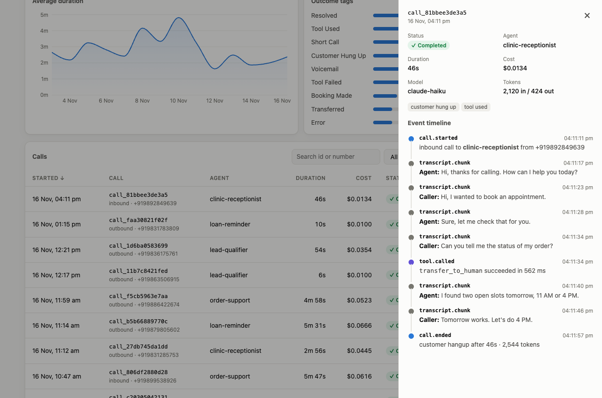

# callflow-dashboard

[](https://github.com/Vedansh-0611/callflow-dashboard/actions/workflows/deploy.yml)

**Live demo: https://vedansh-0611.github.io/callflow-dashboard/**

A React dashboard for AI voice-agent call analytics: KPI cards, calls / cost / duration per
day, outcome tags, a filterable and sortable calls table, and a call detail drawer with the
full event timeline (call started, transcript turns, tool calls, call ended).

It is the frontend for **[callflow-analytics-api](https://github.com/Vedansh-0611/callflow-analytics-api)**,
a Django + DRF + Celery service that ingests signed call webhooks and computes per-call cost.
The live demo runs entirely on bundled mock data, so it needs no backend.


<details>
<summary>Call detail drawer (dark mode)</summary>



</details>

## Stack

React 18, Vite 5, Recharts, plain CSS (custom properties, light and dark themes, responsive
down to phone width). No UI framework. Deployed to GitHub Pages with GitHub Actions.

## Run locally

```bash
npm install
npm run dev            # http://localhost:5173, uses the mock data
```

### Use the real API

Start [callflow-analytics-api](https://github.com/Vedansh-0611/callflow-analytics-api)
(`make up` or `make run`, then `make seed`), then:

```bash
cp .env.example .env.local
# set VITE_API_URL=http://localhost:8000   (and VITE_API_KEY if the API has API_KEY set)
npm run dev
```

The API already allows `http://localhost:5173` through `CORS_ALLOWED_ORIGINS`.

## How it works

- `src/api/client.js` is the single data layer. If `VITE_API_URL` is set it calls
  `/api/calls/`, `/api/calls/<id>/` and `/api/stats/` on the real API. Otherwise it uses
  `src/api/mockApi.js`.
- `mockApi.js` implements the same filters, ordering, pagination and stats response shapes
  in the browser, so the UI code does not know which one it is talking to. Mock timestamps
  are shifted at load time so the newest call is always from the last hour.
- The mock JSON is loaded with a dynamic `import()`, so it is a separate chunk and is not
  downloaded at all when the dashboard points at the real API.
- `scripts/generate-mock.mjs` regenerates `src/mock/calls.json` with a seeded PRNG
  (`npm run mock`). It uses the same cost formula and outcome tag rules as the API.
- `useAsync` is a small hook that loads data when its dependencies change and ignores
  stale responses, so fast filter changes never show out-of-date rows.

```
src/
  api/client.js        real API or mock, same interface
  api/mockApi.js       in-browser mock of the API
  components/          KpiCards, DailyChart, OutcomeTags, CallsTable, CallDrawer, StatusPill
  format.js            number, money, duration and date helpers
  useAsync.js          data loading hook
```

## Deployment

`.github/workflows/deploy.yml` builds on every push to `main` and publishes `dist/` with
`actions/deploy-pages`. Vite's `base` is set to `/callflow-dashboard/` for production builds
because GitHub Pages serves project sites from that sub-path.

## Updating the screenshot

1. `npm run build && npm run preview`, or open the live demo.
2. Use a browser window about 1360px wide and take a full-page screenshot
   (Chrome DevTools: Cmd/Ctrl+Shift+P, then "Capture full size screenshot").
3. Save it as `docs/screenshot.png`. For the drawer image, click any row first and save
   `docs/call-drawer.png`.
